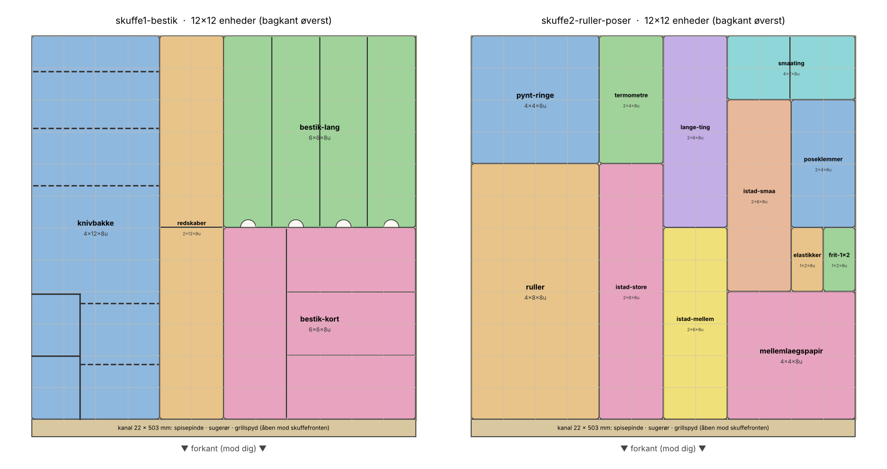
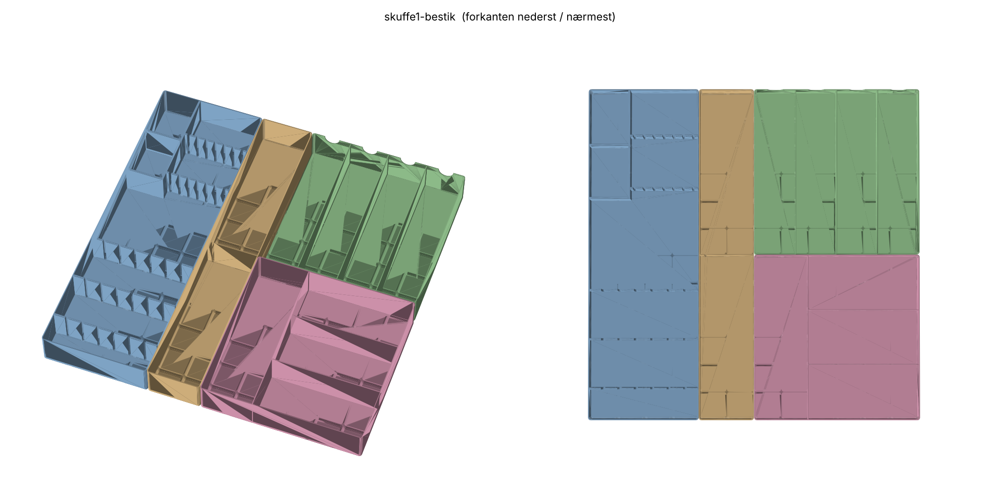
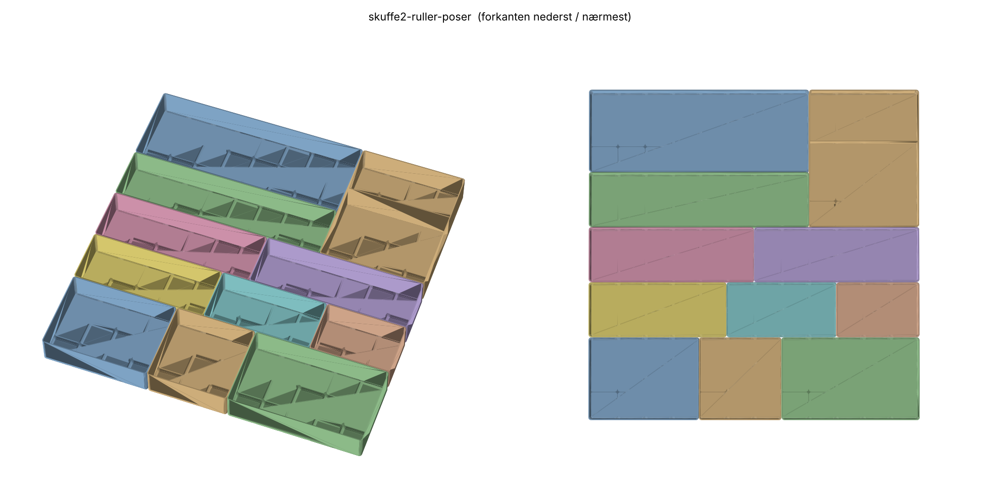

# Gridfinity-indsatser til køkkenskufferne

Printbare skuffeindsatser (bakker uden stable-læbe) til to køkkenskuffer på
**51 × 52,5 cm, maks. 6 cm høje**, oven på den Gridfinity-baseplade der allerede
er printet. Alt er genereret fra `plan.py`, så mål og inddeling kan rettes og
STL-filerne laves igen på få sekunder.



| | |
|---|---|
|  |  |

## Hvad er lavet

* **`stl/`** – printklare STL-filer (6 dele til bestikskuffen, 14 til rulle/pose-skuffen, plus kanalen i to dele pr. skuffe). Se `printliste.md`.
* **`plan.py`** – selve planen: hvilke bakker, hvor store, hvor de står, skillevægge, knivbakke-parametre.
* **`gridfinity.py`** – lille Gridfinity-bibliotek (fodprofil 0,8 / 1,8 / 2,15 mm, 42 mm pitch, 4 mm hjørner).
* **`generate.py`** – laver STL, `layout.svg` og `printliste.md`. **`preview.py`** laver PNG-billederne.

## Forudsætninger

1. **Basepladen** (samme i begge skuffer) er 12 × 12 celler af skeleton-typen, 4,25 mm tyk, med en **22,5 mm stribe
   forrest** langs hele bredden. Bakkerne står reelt på skuffebunden.
2. **Højde.** Bakkerne er 8 enheder = 56 mm, og det går lige under skuffesiden. Knivene står lodret og den
   bredeste klinge (santoku, 45 mm) ender i ca. 53 mm.
3. **Printer: Bambu P1S** (256 × 256 mm). `MAX_PRINT_UNITS = 6` deler lange bakker i stykker på højst 251,5 mm.
   Delte bakker (`-a`, `-b`) har åbne ender mod hinanden og låses sammen af basepladen.
4. **Vægge** er 1,26 mm = 3 linjer à 0,42 mm, både ydervægge og skillevægge.
5. **Bolthoveder** til skuffehåndtaget sidder på indersiden af fronten. Kanalen forrest har derfor ingen forvæg:
   skuffefronten er væggen, og bolthovederne rager bare ind i kanalen.

## Kanalen forrest (begge skuffer)

På basepladens 22,5 mm-stribe står en kanal på 22 × 503 × 50 mm, printet i to halvdele (`kanal-a` og `kanal-b`,
åbne mod hinanden og mod skuffefronten). Den holdes af skuffefronten på den ene side og bakkerækken på den anden.
Skuffe 1: spisepinde og grillspyd. Skuffe 2: sugerør og andet langt og tyndt. Print to sæt.

### Mål der er lagt til grund (bestikskuffen)

| Ting | Mål | Plads |
|---|---|---|
| Køkkenknive | 33 · 31 · 31 · 25 · 22 · 22 cm (lange) og 5 × 21 + 2 × 18 cm (korte) | knivbakke 4×12, 500 mm indvendigt |
| Brødkniv | 39 cm | langs væggen i redskabsbakken, gennem slids i skillevæggen |
| Santoku-klinge, ryg til æg | 45 mm | lodret slids, bund 7 mm over skuffebunden |
| Bamix-skær | ø36 mm, 4 stk. | småtingsrum 59 × 80 mm forrest i knivbakken |
| Store skeer | 21 cm | sammen med spiseskeerne, rum 61 × 249 mm (testprintet) |
| Spisepinde | ca. 24 cm | kanalen forrest, 22 × 503 mm |
| Lange teskeer | ca. 24 cm | rum 61 × 249 mm |
| Spiseknive, gafler, spiseskeer | 1,5 enhed brede | rum 61 × 249 mm |
| Teskeer, børnebestik, kagegafler | korte | tværrum 168 × 82 mm |

## Skuffe 1 – bestik

Fire bakker. Bagkanten er øverst på tegningen; forkanten (mod dig) nederst. De to 6×6-bakker har samme
fodaftryk og kan byttes om når som helst, uden nyt print. Prioriteten er udnyttelse, ikke udseende:
alle rum er i fuld højde, og alt der kan deles med en skillevæg i stedet for to bakkevægge, er det.

* **Knivbakke 4×12** (164 × 500 mm indvendigt), printes i to halvdele.
  * Bagerst: tre ribber med 6 lodrette slidser i 25 mm deling til de lange knive, spidserne mod bagvæggen.
    Fra venstre: 33, 31, 31, 25, 22, 22 cm.
  * Forrest: to ribber med 7 slidser i 15 mm deling, skubbet mod højre. Fra venstre: 18, 18, 21, 21, 21, 21, 21 cm.
    Fordelingen er ikke tilfældig: de to urteknive ligger foran de to 31 cm-knive (31 + 18 = 49 cm i en 50 cm kolonne),
    og steakknivene ligger foran 25/22/22, som slutter senest 25 cm inde. Byttes der rundt, støder spidser og håndtag sammen.
  * Forrest til venstre, foran de lange knives håndtag: to småtingsrum på 59 × 80 mm. Bamix-skærene i det ene,
    det andet frit.
  * Slidserne er 4 mm brede med rund bund 7 mm over skuffebunden. Ret `KnifeTray(...)` i `plan.py`.
* **Redskaber 2×12** (81 × 500 mm indvendigt), printes i to halvdele, to rum i fuld højde på 249 mm:
  piskeris, ostehøvl og lange redskaber i det ene, hvidløgspresser, rivejern og proptrækker i det andet.
  **Brødkniven på 39 cm** ligger på højkant langs venstre væg med spidsen mod bagvæggen og går gennem en 4 mm
  slids i skillevæggen; håndtaget ender i rum 2. Den koster ingen plads i knivbakken, hvor fire knive over 29 cm
  ikke kan få hver sin fri kolonne i 164 mm bredde.
* **Bestik-lang 6×6** (bagerst): fire rum på 61 × 249 mm med greb-hak: spiseknive, gafler, spiseskeer (også dem på
  21 cm) og lange teskeer. Testprintet bekræftede, at 61 mm er nok til alle tre hovedtyper.
* **Bestik-kort 6×6** (forrest): til venstre en kolonne på 80 × 249 mm til måleskeer, pizzahjul, te-si og
  småværktøj. Til højre tre tværrum på 168 × 82 mm til teskeer, børnebestik og kagegafler.
* **Kanalen** forrest: spisepinde og grillspyd.

## Skuffe 2 – ruller, poser og småting

Tolv bakker, alle 8 enheder høje. Det daglige ligger forrest eller i kolonner på langs, så æskens ende sidder
ved forkanten og kan gribes direkte. Det sjældne ligger bagerst.

* **Ruller 4×8** (164 × 332 mm, to halvdele) langs venstre side: film, sølvpapir, cellofan og fryseposer på rulle
  ved siden af hinanden på langs. Fire ting på 164 mm kræver, at de hver er under ca. 40 mm brede. Er de bredere, må
  en af dem flyttes, eller kolonnen gøres 5 enheder bred (så skal kolonnerne til højre rykkes).
* **ISTAD i tre kolonner** på langs, alle 80 mm brede: 29,5 cm i 2×8 (332 mm, to halvdele), 23 cm i 2×6 (248 mm) og
  19 cm i 2×6 (248 mm). De to store ender ved forkanten, den lille lige bag papiret.
* **Mellemlægspapir 4×4** forrest til højre (164 × 164 mm til æsken på 15 × 12,5 cm, plus tændstikker ved siden af).
* **Poseklemmer 2×4**: alle klemmer (13,5 / 10,5 / 5 cm) i ét rum på 80 × 164 mm i fuld højde.
  **Elastikker 1×2** (37 × 80 mm) lige foran, bag papiret, med et frit 1×2-rum ved siden af.
* **Bagerst:** Pynt-ringe 4×4 (ringe til glas, fødselsdagsflag, parasoller), Termometre 2×4 (plus snor),
  Lange ting 2×6 (trægafler, sushi-måtte, poser på rulle; sugerør ligger i kanalen) og Småting 4×2 med skillevæg (tandstikker og barberblade
  i det ene rum, tændstikker og fødselsdagslys i det andet).

## Print

* PLA eller PETG, 0,2 mm lag, 3 perimetre, 10–15 % infill, ingen support (filerne står rigtigt).
  Bunden er massiv i modellen, så sliceren fylder den med infill; vægten i `printliste.md` er regnet
  massivt og er derfor i overkanten (se totalen nederst i `printliste.md`).
* Vægge er 1,26 mm, gulvet 6 mm over fodens bund. Alt kan vaskes i hånden; PETG tåler opvaskemaskine bedre.
* Print de små 3×3-bakker først og tjek at de passer i din baseplade, før du printer de store.

## Generér igen

```bash
pip install manifold3d trimesh numpy matplotlib
python3 generate.py            # STL + layout.svg + printliste.md
python3 generate.py --max 5    # kortere stykker til 250/220 mm-plader
python3 generate.py --only knivbakke
python3 preview.py             # PNG-billeder i preview/
```
